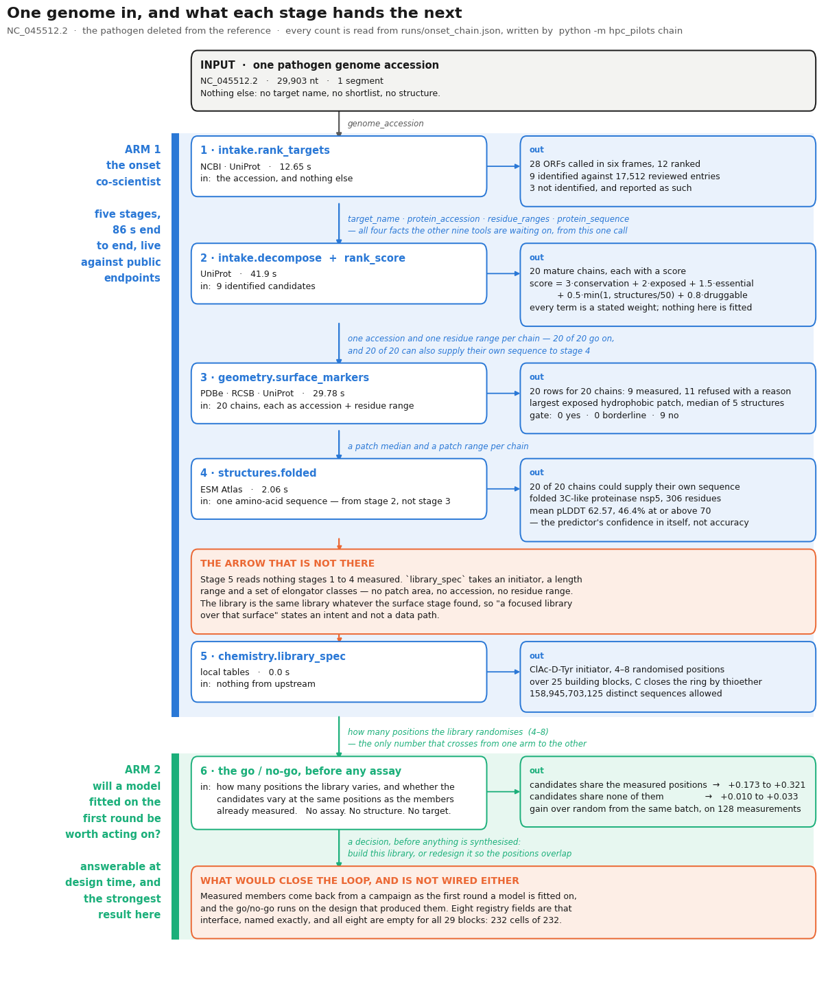

# bind-the-unknown

**Before a library is synthesised, this says whether a model fitted on the first round of
measurements will be worth acting on.** That is a property of how the library was designed rather
than of the target, so the answer is available at design time and costs no assay to get. Where the
candidates share randomised positions with the members already measured, a weak model trained on
128 measurements picks good binders well enough to act on: a mean gain of +0.173 to +0.321 over
picking at random from the same batch. Where they share no positions, the gain is +0.010 to +0.033
and nothing downstream recovers it. The result is established on published datasets of canonical
protein variants, which is why a SynX campaign is its natural next test.

**The rest of this system gets you to a library worth asking that question about.** From a
pathogen genome accession and nothing else, it ranks candidate targets, folds the one it picks,
measures the surface a macrocyclic peptide would have to bind, and defines a focused
thioether-macrocycle library for that molecule class. The library definition does not yet read
the measured surface, which the flowchart below names as the missing arrow it is. It runs today
against public endpoints at NCBI, UniProt, Europe PMC, EBI HMMER, InterPro, PDBe, 3D-Beacons,
AlphaFold DB, ESMFold, RCSB and ChEMBL, and it has been run across three virus families.

**Start with the notebook.** [notebooks/double_arm_mvp.ipynb](notebooks/double_arm_mvp.ipynb)
runs the whole path in one sitting and computes every number it shows when the cell executes. It
is committed with its outputs, so GitHub renders all of it without running anything.

---

## The two arms, and what flows between them

**Arm 1 runs from a genome accession. Arm 2 answers one question about a library design. One
number crosses between them.** Every count below is read from
[runs/onset_chain.json](runs/onset_chain.json), written by `python -m hpc_pilots chain`, which
runs all five stages on the SARS-CoV-2 reference genome against the live endpoints. §0.1 of the
notebook draws the same record as a figure.



**The figure is drawn with SARS-CoV-2 deleted from the reference**, which is the setting every
validation run below uses. `python3 output/build_pipeline_figure.py` redraws it from
`runs/onset_chain.json`, and `--case 0` draws the same genome identified through its own curated
entries instead. It calls the same function §0.1 of the notebook calls, so the image, the
notebook page and the record cannot drift apart.

**The two arrows that are not there are the point of drawing this**, and the figure gives each
one a panel of its own rather than leaving it to be noticed. `chemistry.library_spec` takes an
initiator, a length range and a set of elongator classes. It takes no patch area, no accession
and no residue range, so the library it defines is the same library whatever stage 3 measured:
"a focused library over that surface" states an intent and not a data path. And the campaign
data that would feed arm 2's answer back into the next design does not exist yet.

**The chain is recorded twice, because the reference changes what every later stage receives.**
Identified through its own curated entries, the later stages work — the residue ranges are the
pathogen's own, so the surface stage measures 20 of 21 chains and the folding stage locates
21 of 21 inside the genome's own translation, reproducing the committed main-protease
fold byte for byte — but conservation is identity to the nearest curated relative, the nearest
relative is the protein itself, and the heaviest term in the rubric scores every candidate
alike. With SARS-CoV-2 deleted from the reference, which is what every validation run below
uses, the ranking separates and the surface stage loses part of its input:
9 of 20 chains keep a measurable surface. Neither case alone is the system.

**No chain is dropped between stages in either case, or on any genome**, which was not true
until this record existed. `intake.enrich_with_surface` had no caller anywhere in the package,
so the only surfaces ever measured were six named by hand, and SARS-CoV-2's RNA-directed RNA
polymerase — fifth of the ranked candidates, with an approved antiviral against it — was never
asked about. It measures 486.6 square angstroms with a spread of 1319.8 across five
structures of the same domain, and gates `no` on localisation: the polymerase is inside
the cell.

**The same five stages run on three pathogens from three viral families**, in
[runs/onset_chain_genomes.json](runs/onset_chain_genomes.json), each with its own organism held
out. The invariant holds on all of them and the coverage behind it does not: 9 of 20 ranked
chains keep a measurable surface for SARS-CoV-2, 6 of 8 for Nipah, and 0 of 9 for influenza —
whose reviewed entries are split so finely by strain that the nearest relative of a held-out
protein is usually an entry with no deposited structure of its own, although influenza proteins
are among the best solved in virology. That spread is what says the coverage number is a
property of the pathogen rather than of the code.

**And §0.2 of the notebook takes a pathogen of your own**, as does
`python -m hpc_pilots chain --accession <id> --pathogen <name>`. MERS-CoV, `NC_019843.3`, a
genome nothing here had looked at: 19 chains ranked, 19 surface rows for them, 19 of 19 located
in the genome's own translation, and the main protease it folded hashes to something that is
not SARS-CoV-2's — it found MERS's own, through a coronavirus relative, which is what the
system claims to do. A genome too large to be viral is refused rather than ranked: this is
antiviral work, and the reference it identifies against is reviewed viral proteins.

---

## What this produces, from a genome to a library

**Five things come out of this system, and each one is an object you can hold.** The notebook
builds them in order.

**A target, chosen from a pathogen genome rather than from a shortlist.** The only input is one
genome accession. The pipeline reads that genome in all six frames to get every protein it could
encode, matches those against reviewed UniProt entries, and ranks what it finds. It has run on
SARS-CoV-2, Nipah virus and influenza A PR8, each time with the pathogen's own proteins
deleted from the reference so identification had to work through a relative.

**A structure for that target, including for a protein with no close curated relative.** The
folding tool takes an amino-acid sequence and returns coordinates, which is the one structural
route open to a protein nobody has solved. The committed example is in
[runs/folded_structure/](runs/folded_structure/): the 306-residue SARS-CoV-2 main protease, 193227
bytes of coordinates. The predictor's own confidence in each residue averages 62.57 out of 100,
and 46.4 per cent of residues are at or above 70. Confidence is not accuracy.

**A measured binding surface on that target.** The surface tool measures the largest unbroken
exposed greasy area on the outside of the protein, which is what a macrocycle has to lie across.
It reports a median with the spread over replicate structures of the same domain. At a 10
angstrom contact cutoff the spike receptor-binding domain carries 682.2 square angstroms against
the main protease's 415.2. **That ordering is the reverse of a conventional small-molecule
druggability score, and the right way round for macrocycles**, which bury a few hundred square
angstroms flat rather than reaching into a pocket.

**A focused library definition for that molecule class.** `chemistry.library_spec` returns a
chloroacetyl initiator, `ClAc-D-Tyr`, a randomised region of 4 to 8 positions drawn from 25
building blocks, and a cysteine that closes the ring through a spontaneous thioether. The
definition allows 158,945,703,125 distinct sequences. It takes an initiator, a length range
and a set of elongator classes, and nothing the surface stage measured, so the library is the
same library whatever target it was reached from. That is the one break in the chain that is a
design gap rather than a measurement limit.

**A go/no-go on whether modelling will help for that library, before any assay.** That is the
result in the opening paragraph, measured in [what has been measured](#what-has-been-measured).
It is the strongest thing here, because a property of the design can be read off the moment the
library is specified.

## How the target gets chosen

**You cannot call a tool because it sounds relevant. You can call it only when you already have
what it needs.** From a genome accession alone, the folding tool has no sequence to fold, and the
family, predicted-structure, surface and bioactivity tools have no protein accession to look up.
Those tools are not expensive and not irrelevant, they have nothing to act on yet. Matching a
query against tool descriptions never finds that out, because the obstruction is in what you know
and not in the words.

So each tool declares what it needs and what its result supplies, and the selector proposes all
10 of them in a fixed order:

1. Tools you can run now, before tools you cannot.
2. Among those, whichever produces the facts most other tools are waiting on.
3. Then whichever answers more of the questions still open about the target.
4. Then name, so the order is total and a run reproduces.

**The second rule before the third is the real judgement.** A call that makes other calls possible
changes what every later round may do, while a call that answers one open question changes one
number. Tools you cannot run yet are reported rather than dropped, each naming the fact it lacks.

From a bare genome accession, five of the 10 tools are runnable. Identification is the only one of
the five that produces facts the others need, and it produces all of them, so the chain has a
single bottleneck.

| Tool | What you get | Reads |
| --- | --- | --- |
| `intake.rank_targets` | Genome accession in, ranked candidate targets out | NCBI, UniProt |
| `literature.search` | Date-limited literature for a name or accession | Europe PMC |
| `similarity.homologs` | Related proteins in other organisms, with identity | EBI HMMER |
| `families.entries` | Families, domains and sites, with residue ranges | InterPro |
| `structures.evidence` | Dated structural coverage for a named target | PDBe, UniProt |
| `structures.predicted` | Predicted models, with per-range confidence | 3D-Beacons, AlphaFold DB |
| `structures.folded` | Coordinates for one amino-acid sequence | ESMFold |
| `geometry.surface_markers` | The surface area a macrocycle would cover | RCSB, PDBe |
| `bioactivity.prior_binders` | Prior bioactivities, assay formats, public scans | ChEMBL, IEDB, MaveDB |
| `chemistry.library_spec` | A focused macrocycle library over a randomised region | Local tables |

**Four of them fetch real material and are deliberately not allowed to settle a question on
their own.** They return evidence a person still has to weigh, so the system records what
they found and does not let a hit count stand in for a measurement.

## What has been measured

Every number below comes from a dataset where the outcome was already known for every candidate
and then hidden behind an evaluator. A decision procedure asks for a few outcomes at a time under
a fixed budget, and what it chose is scored against the hidden truth. Grading is therefore exact
and automatic, and needs no human reviewer and no laboratory. Each run below is a record in
[runs/](runs/) carrying its own question and answer.

### Choosing the target

Two of the three pathogens beat a random ranking of their own candidates, at p = 0.000862 and
0.0121. Nipah virus, with three targets among eight candidates, is underpowered at that size
and is recorded as not established rather than as a pass or a failure.

| Experiment | What it found |
| --- | --- |
| `intake_validation` | With the pathogen's own proteins removed from the reference, the ranking still recovers the real countermeasure targets across three virus families. |
| `holdout_ladder` | Delete ever-closer relatives from the reference and the pipeline does not degrade, it **stops**. It needs a known relative from the same species or at least the same genus. |
| `identification_cascade` | Past that point, conserved enzymes still come back through distant matches. Family-specific surface proteins have no distant relatives, so they are recognised from their own sequence instead, as a surface protein rather than by name. Those are the antibody targets. |
| `surface_markers` | Scoring the largest unbroken exposed greasy area puts the spike receptor-binding domain above the main protease at every contact cutoff measured, so a target can be scored from structure without penalising the interfaces macrocycles exist to bind. |
| `amenability_gate` | Over five structures of the same domain the patch moves by up to 1850 square angstroms, against one macrocycle footprint of 600, so the gate reports the range with the median inside it. Generated from `configs/structures.json`, so all 12 declared targets get a row: 11 measured, 1 refused with the reason. The band now has an edge on both sides: a patch covering more than 15% of its domain's own surface is a region rather than a site and cannot read `yes`. |
| `onset_chain` | One genome in, and what each of the five stages handed the next, under both references. The surface stage emits one row per ranked chain, measured or refused, in both. |
| `onset_chain_genomes` | The same five stages on 3 pathogens from three viral families, each held out from its own reference. One surface row per ranked chain on every genome; how many of those rows carry a measurement runs from 9 of 20 to 0 of 9. |

### The result

**Whether a model helps depends on whether the candidates vary at the same sequence positions as
the members already measured.** When they do, a weak model fitted on 128 measurements picks
held-out binders well enough to act on. When they do not, correlation sits near 0.1.

Correlation alone could not establish that, so it was tested by intervening in both directions
with everything else held fixed. These rows are quoted from
[ADJUDICATION_COMBINATORIAL_GAIN.md](ADJUDICATION_COMBINATORIAL_GAIN.md).

| Intervention | Gain over random | Model correlation |
| --- | --- | --- |
| Influenza H3, batches narrowed to 28 variable positions | +0.104 to **+0.250** | 0.10 to 0.63 |
| The same, widened to 55, 150 and 566 positions | +0.159, +0.019, 0.000 | 0.42, 0.18, 0.10 |
| GB1 double mutants relabelled to share no positions | +0.242 to **−0.019** | 0.66 to 0.03 |

The first takes the pathogen case that had looked like a failure and recovers the whole effect by
narrowing the batch. The second keeps the same variants, the same hidden scores and the same
combinations, removes only the sharing of positions, and the effect goes away.

**It then held on two unrelated proteins against a prediction committed to the repository before
the test ran.** [PREREGISTRATION_COVERAGE.md](PREREGISTRATION_COVERAGE.md) predicted at least
+0.15 improving in at least 7 of 10 batches and reports +0.254 on both. Recomputed from the
per-batch records, the replication gives +0.2423 on the GRB2 SH3 domain improving in 10 of 10
batches and +0.2077 on KRAS in 8 of 10.

**The split holds across all eight datasets at the matched 512-candidate batch**, each reformatted without
changing a measurement. The four varying more than two positions gain +0.173 to +0.321, and the
four varying two positions gain +0.010 to +0.033. The ranges do not overlap, and the exact
permutation over dataset labels gives 1 of 70 arrangements, p = 0.014.

**The favourable regime is a randomised region of a few positions over an alphabet**, which is
what an mRNA display library is. A weak predictor is enough, but there has to be one, and whether
one can be fitted is knowable in advance.

## Where this meets a SynX campaign

**This system picks a target, measures the surface a macrocycle would have to bind, defines a
focused library over it, and says in advance whether a model fitted on the first round of
measurements would be worth trusting.** What it has not done is measure a macrocycle itself.

**The chemistry is represented down to the field.** `hpc_pilots/chemistry.py` holds 29 building
blocks, 20 canonical and 9 non-canonical classes, reached through the `chemistry.library_spec`
tool that the `invoke_design_tool` action dispatches. One published dataset staged here is a real
macrocycle library: `thrombin_cyclic` holds 8,448 unique cyclic peptides built from named
non-canonical monomers against a quantitative thrombin endpoint. Two cyclisation chemistries are
modelled explicitly, and SMILES were recovered for 47 monomers so molecular descriptors could be
computed.

**What this repository cannot supply is the per-block data that only a campaign produces.** The
block registry has 13 fields. The module fills five itself, and eight come from a platform export:
chemical identifier, CCD code, SMILES, stereochemistry descriptor, molecular weight, reprogrammed
codon, Rosetta parameters and rotamer library. All eight are empty for all 29 blocks, 232 cells of
232. Those eight fields are the interface, named exactly, which is why the loop closes the moment
that data exists. Measured members come back as the first round a model is fitted on, the go/no-go
test runs on the design that produced them, and the next library definition is chosen with that
model in hand.

Three questions about the handoff are open:

- In what form should a library definition arrive to be synthesisable as written, block codes
  against your own catalog or a structure per position?
- Which endpoint should a model be fitted on, enrichment across selection rounds or a measurement
  on the picked members afterwards?
- How many positions does a campaign's randomised region usually vary, since that count is the one
  input the go/no-go test needs?

## The notebook

**[notebooks/double_arm_mvp.ipynb](notebooks/double_arm_mvp.ipynb) is the shortest route through
this project**, and §1.2 dispatches real calls against the real endpoints while it is open,
printing what each one spent in seconds and outbound requests. Set `LIVE = False` and the panels
play back calls recorded earlier instead of making new ones, which is what to do in a room with no
network. Nothing is retyped: every figure is computed from [runs/](runs/) or from a live
return when the cell executes.

| § | Section | What you see |
| --- | --- | --- |
| 0 | Setup and data availability | Which records this machine can see, before anything reads one |
| 0.1 | The whole workflow on one page | The two arms as a flowchart, drawn from one run of the chain |
| 0.2 | Run it on a pathogen of your own | One NCBI accession in, the whole chain out, live |
| 1.1 | Reachability, not relevance | Which tools you can actually run from a bare accession, ranked live |
| 1.2 | Watching a tool run | Calls dispatched live, each as an instrument readout, with a structure |
| 1.3 | What the recorded runs found | Each recorded experiment, reporting its own answer field |
| 1.4 | Genome to ranked targets | Recovered countermeasure targets across three virus families |
| 1.4a | Every candidate's score, term by term | The five stated weights, and what each protein earned on each |
| 1.5 | The identification cliff | Where the pipeline stops rather than degrades |
| 1.6 | The surface a macrocycle would bind | Patch medians with the spread across replicate structures |
| 1.6a | Every chain, and nothing dropped | One surface row per ranked chain, measured or refused with the reason |
| 1.6b | The same stages on three pathogens | Coverage as a property of the pathogen, not of the code |
| 2.1 | The result | Gain against shared positions, from the per-batch records |
| 2.2 | Tested by intervention | Narrow the batch and the effect returns; remove sharing and it goes |
| 2.3 | What a campaign supplies | The chemistry that is wired, and the fields a campaign fills |
| 3 | One genome in, a ranked candidate list out | The whole chain on SARS-CoV-2, ending in a ranked shortlist |

**§0.2 takes a pathogen of your own, and it is near the top for that reason.** One NCBI
nucleotide accession goes in — several separated by commas for a segmented genome — and the
same five stages run against the same endpoints, printing the same ledger, for a pathogen
nothing here has looked at. No target list, no structure, no name. A genome too large to be
viral is refused rather than ranked: nothing would identify against a reviewed viral reference,
and a confident wrong shortlist is the one output worse than none.

**Budget the cold number, not the cached one.** Registered costs run from 0.7 seconds for a fold
to 94 seconds for the bioactivity lookup, but that 0.7 seconds is a cached result.
[hpc_pilots/folded_structure.py](hpc_pilots/folded_structure.py) measures a cold fold at 1.8, 5.0,
12.1 and 25.6 seconds for 50, 200, 300 and 400 residues, and 12.8 seconds for the 306-residue main
protease. Every target here is cold on first sight.

Every record the notebook reads is committed, so the whole thing runs in a fresh clone with no
rebuild step. The spinnable 3D view needs a browser and a
network, so §1.2 draws a static structure beside it that renders everywhere. The panel machinery
those sections render through is in [notebooks/panels.py](notebooks/panels.py) rather than in a
cell, so the page opens on the calls and their output instead of on their plumbing.

```bash
pip install -r hpc_pilots/requirements.lock.txt   # the pipeline
pip install -r notebooks/requirements.txt         # the notebook's own extras
jupyter lab notebooks/double_arm_mvp.ipynb        # or: jupyter notebook
```

## Running it, and what is in the repository

| Path | What is in it |
| --- | --- |
| [notebooks/](notebooks/) | The runnable walkthrough, committed with its outputs. |
| [hpc_pilots/](hpc_pilots/) | All the code: 40 modules, about 19,000 lines, the SLURM layer, and the dataset, target, method and tool-set definitions in [configs/](hpc_pilots/configs/). |
| [runs/](runs/) | Recorded results, one file per experiment. |
| [reviews/](reviews/) | Adversarial and confound reviews. |
| [output/](output/) | Figures and the Markdown-to-PDF builder for the documents. |

Staged data is gitignored and rebuilt by the `prepare` commands: 10 datasets, including GB1 at
149,360 rows and a 536,962-row GB1-Olson scan, plus evidence packets covering 11 targets across
three viral families.

Model access is configured by environment variable (`PILOT_LLM_PROVIDER`, `PILOT_LLM_MODEL` and a
provider key) read from a gitignored `.env`, documented in [.env.example](.env.example). No secret
is in the repository. Every download records where it came from and when, and every run records
the dataset and the settings it used.

```bash
python -m hpc_pilots prepare                              # GB1 + ATLAS selection manifest
python -m hpc_pilots prepare-target --landscape mpro      # one pathogen dataset
python -m hpc_pilots target --landscape mpro --pool 0 --policy ucb --delay 3
python -m hpc_pilots targets                              # build the evidence packets
python -m hpc_pilots chain                                # one genome through every stage, both references
python -m hpc_pilots chain --genomes                      # the same stages on three pathogens
python -m hpc_pilots chain --accession NC_019843.3 --pathogen MERS-CoV   # or one of your own
python -m hpc_pilots gate                                 # the amenability gate over every declared target
python -m hpc_pilots chemistry                            # build the block registry
python -m hpc_pilots emergency --family coronaviridae --policy agent
python -m hpc_pilots calibration
python -m hpc_pilots summarize
python -m hpc_pilots.submit --with-agent                  # the SLURM chain
```

## Documents

Read or run [notebooks/double_arm_mvp.ipynb](notebooks/double_arm_mvp.ipynb) first. These four set
out the reasoning in full, and are committed as PDFs as well as Markdown.

1. **[PROJECT_OVERVIEW_AND_PLAN.md](PROJECT_OVERVIEW_AND_PLAN.md)**, the project in one sitting:
   the goal, what has been measured, the targets and the evaluation design.
2. **[ARCHITECTURE.md](ARCHITECTURE.md)**, the system and the reasoning behind it, organised
   around why rather than as an API listing.
3. **[ADJUDICATION_COMBINATORIAL_GAIN.md](ADJUDICATION_COMBINATORIAL_GAIN.md)** and
   **[PREREGISTRATION_COVERAGE.md](PREREGISTRATION_COVERAGE.md)**, the intervention tests behind
   the result and the prediction committed before it ran.
4. **[reviews/](reviews/)**, the adversarial and confound reviews, written against this project's
   own claims.
